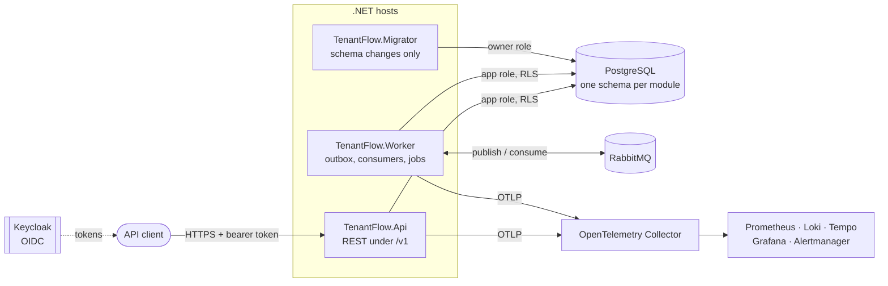

<div align="center">

# TenantFlow

**A production-grade, multi-tenant B2B SaaS backend in .NET, built as a modular monolith.**

[](LICENSE)


[Overview](#overview) · [Quick start](#quick-start) · [Architecture](#architecture) ·
[Patterns](#engineering-patterns) · [Testing](#testing) · [Docs](#documentation)

</div>

---

## Overview

Each business that signs up is a **tenant**. Through a versioned REST API, a tenant manages its catalog, inventory,
orders, payments, subscriptions, refunds, CSV imports and exports, and its audit history. There is no frontend.

TenantFlow is a learning and portfolio project built to the standard of a real system, focused on where real systems
break:

| Problem | How TenantFlow handles it |
|---|---|
| One tenant seeing another's data | Access comes from an active membership, backed by PostgreSQL row-level security |
| Charging a customer twice | Idempotency keys, a payment saga and reconciliation |
| Selling stock you do not have | Per-tenant serialized reservations that never go negative |
| Losing or duplicating messages | Transactional outbox, idempotent consumers, retries, dead-letter queue |
| Not knowing what broke | OpenTelemetry end to end, SLOs with burn-rate alerts, runbooks as code |

**By the numbers:** 37 ADRs · per-feature specs · threat models · 750+ automated tests against real PostgreSQL and RabbitMQ.
**Status:** milestones M0–M10 done, M12 (AWS deployment) in progress — see the [roadmap](docs/roadmap.md).

## Quick start

**You need:** [.NET SDK 10.0.402+](https://dotnet.microsoft.com/download/dotnet/10.0) (pinned in `global.json`) and
[Docker](https://docs.docker.com/get-docker/) with Compose v2. No scripts, no secrets to create.

**1. Start the infrastructure** (PostgreSQL, Keycloak, RabbitMQ, and the migrations):

```bash
git clone <repository-url> tenantflow
```

```bash
cd tenantflow
```

```bash
docker compose up -d --wait
```

If Docker runs inside WSL, prefix with `wsl`. The first run takes a few minutes; after pulling new migrations, add `--build`.

**2. Start the API and the Worker:**

- **Visual Studio:** open `TenantFlow.sln`, pick the **API + Worker** profile, press **F5**.
- **Rider / VS Code:** run the `http` profile of `TenantFlow.Api` and `TenantFlow.Worker`.
- **Terminal:** `dotnet run --project src/Hosts/TenantFlow.Api` and, in a second terminal, `dotnet run --project src/Hosts/TenantFlow.Worker`.

**3. Make your first call:**

```bash
curl -s -X POST http://localhost:8080/realms/tenantflow/protocol/openid-connect/token -d grant_type=password -d client_id=tenantflow-dev-cli -d username=dev-user-a -d password=tenantflow-dev-user-local-only
```

```bash
curl -H "Authorization: Bearer <access_token>" http://localhost:5080/v1/me
```

Platform-operator routes (`/v1/platform/...`) use realm `tenantflow-platform` and user `dev-operator`.

### Local services

| Service | Address | Sign-in |
|---|---|---|
| API | http://localhost:5080 | Bearer token |
| API reference (Scalar) | http://localhost:5080/scalar/v1 | Paste a token |
| OpenAPI document | http://localhost:5080/openapi/v1.json | Anonymous |
| Health | `/health/live`, `/health/ready` on :5080 (API), :5081 (Worker) | Anonymous |
| Keycloak | http://localhost:8080/admin | `admin` / `tenantflow-local-only` |
| RabbitMQ | http://localhost:15672 | `tenantflow` / `tenantflow-rabbitmq-local-only` |
| Grafana | http://127.0.0.1:3000 | `admin` / `tenantflow-local-only` |

Passwords are throwaway local values and every port binds to `127.0.0.1`. Grafana needs
`docker compose --profile observability up -d --wait`. To stop: `docker compose down` (add `-v` to delete the data).
More in the [local environment guide](docs/operations/local-environment.md); shortcuts for the daily loop (HTTP
walkthrough, solution filters, test filters, snippets) are in [developer productivity](docs/operations/developer-productivity.md).

## Architecture

A **modular monolith**: one deployable codebase split into business modules with hard boundaries, so any module could
become its own service without a rewrite.



Each module in `src/Modules/<Name>` has four projects — **Domain**, **Application**, **Infrastructure** and
**Contracts** — and other modules may use it **only** through `Contracts`. Architecture tests enforce this.

**Modules:** Tenants · IdentityAccess · Catalog · Inventory · Orders · Payments · Subscriptions · Notifications ·
ImportsExports · Audit · Operations

```text
tenantflow/
├── src/
│   ├── Hosts/            Api, Worker, Migrator
│   ├── Modules/          One folder per business module
│   └── BuildingBlocks/   Messaging, persistence, scheduling, observability, validation
├── tests/                Unit, API, architecture, database, smoke, security, drills
├── tools/                Progress dashboard
├── deploy/               Compose services, production images, Terraform for AWS
└── docs/                 Requirements, roadmap, ADRs, specs, threat models, runbooks
```

## Engineering patterns

Every pattern links to the decision record explaining why it was chosen.

<details>
<summary><b>Architecture and design</b></summary>

| Pattern | Decision |
|---|---|
| Modular monolith with layered modules | [ADR-0002](docs/architecture/decisions/0002-modular-monolith.md) |
| Schema per module | [ADR-0012](docs/architecture/decisions/0012-module-data-ownership.md) |
| Use cases as application services (no mediator) | [ADR-0013](docs/architecture/decisions/0013-use-case-dispatch.md) |
| Ports and adapters (payments, object storage) | [ADR-0022](docs/architecture/decisions/0022-payments-provider-port-and-order-payment-saga.md), [ADR-0024](docs/architecture/decisions/0024-object-storage-and-async-import-export-jobs.md) |
| Explicit state machines (orders, payments, refunds) | [ADR-0020](docs/architecture/decisions/0020-orders-and-reservations.md) |

</details>

<details>
<summary><b>Reliability and distributed systems</b></summary>

| Pattern | Decision |
|---|---|
| Transactional outbox, idempotent consumers, retries and dead-letter queue | [ADR-0021](docs/architecture/decisions/0021-messaging-broker-outbox-and-consumers.md) |
| Order-payment saga, idempotency keys, reconciliation, signed webhooks | [ADR-0022](docs/architecture/decisions/0022-payments-provider-port-and-order-payment-saga.md) |
| Per-tenant serialization with advisory locks | [ADR-0018](docs/architecture/decisions/0018-serialized-tenant-changes-with-advisory-locks.md) |
| Persistent scheduling with Quartz.NET | [ADR-0023](docs/architecture/decisions/0023-subscriptions-renewal-scheduler-and-refunds.md) |
| No remote calls inside a transaction | [AGENTS.md](AGENTS.md), rule 3 |

</details>

<details>
<summary><b>Security and multi-tenancy</b></summary>

| Pattern | Decision |
|---|---|
| Tenant isolation with row-level security | [ADR-0011](docs/architecture/decisions/0011-postgresql-row-level-security.md) |
| OIDC with Keycloak | [ADR-0009](docs/architecture/decisions/0009-identity-provider-and-oidc-boundary.md) |
| Separate trust boundaries for users and operators | [ADR-0010](docs/architecture/decisions/0010-trust-boundaries-between-user-types.md), [ADR-0027](docs/architecture/decisions/0027-platform-admin-and-support-operator-boundary.md) |
| Least-privilege database roles | [ADR-0012](docs/architecture/decisions/0012-module-data-ownership.md) |
| Append-only audit log and retention | [ADR-0026](docs/architecture/decisions/0026-audit-module-and-append-only-audit-log.md), [ADR-0025](docs/architecture/decisions/0025-compliance-goals-data-classification-and-retention.md) |
| Problem Details errors (RFC 9457) | [ADR-0016](docs/architecture/decisions/0016-error-model-and-problem-details-contract.md) |
| Supply-chain and security scanning | [ADR-0028](docs/architecture/decisions/0028-security-scanning-in-the-pipeline.md) |
| Threat models tracked to tests | [docs/threat-models](docs/threat-models/README.md) |

</details>

<details>
<summary><b>Observability and operations</b></summary>

| Pattern | Decision |
|---|---|
| Traces, metrics and logs with OpenTelemetry | [ADR-0007](docs/architecture/decisions/0007-logging-pipeline.md) |
| SLOs and burn-rate alerts | [ADR-0030](docs/architecture/decisions/0030-slos-error-budgets-and-burn-rate-alerting.md) |
| Dashboards and alerts as tested code | [ADR-0029](docs/architecture/decisions/0029-observability-as-code-dashboards-and-alerting.md) |
| Runbooks and fault drills | [Runbooks](docs/operations/runbooks/README.md), [drills](docs/operations/drills/README.md) |
| Log redaction | [ADR-0031](docs/architecture/decisions/0031-log-redaction.md) |
| AWS infrastructure with Terraform | [ADR-0032](docs/architecture/decisions/0032-aws-and-managed-container-hosting.md), [ADR-0033](docs/architecture/decisions/0033-terraform-layout-remote-state-and-secrets.md) |

</details>

<details>
<summary><b>Tech stack</b></summary>

| Area | Technology |
|---|---|
| Runtime | C# on .NET 9 (target: .NET 10 LTS), analyzers as errors |
| Web API | ASP.NET Core minimal APIs, `/v1` versioning, OpenAPI, Scalar |
| Data | PostgreSQL 17, EF Core, row-level security |
| Messaging and jobs | RabbitMQ 4, Quartz.NET |
| Identity | Keycloak 26, JWT bearer |
| Payments | Deterministic simulator, Stripe test mode |
| Observability | OpenTelemetry, Prometheus, Loki, Tempo, Grafana, Alertmanager |
| Testing | xUnit v3, `WebApplicationFactory`, Testcontainers, promtool |
| Security | gitleaks, Trivy, NuGet audit |
| Cloud | AWS ECS Fargate, RDS, Amazon MQ, Terraform, GitHub Actions |

</details>

## Testing

| Command | Checks | Needs |
|---|---|---|
| `dotnet test TenantFlow.sln -c Release` | **The gate (same as CI):** build with warnings as errors, unit, API and architecture tests | Nothing |
| `dotnet run --project tests/Database/TenantFlow.Database.Tests -c Release` | RLS, migrations, cross-tenant denial, outbox on real databases | Local stack |
| `docker compose --profile checks run --rm rule-tests` | Prometheus and Alertmanager rules | Docker |
| `dotnet run --project tests/Smoke/TenantFlow.Smoke.Tests -c Release` | End to end against live hosts | Observability profile + hosts |
| `dotnet run --project tests/Security/TenantFlow.Security.Tests -c Release` | Secrets, vulnerable packages, image CVEs, IaC | Docker + network |
| `dotnet run --project tests/Drills/TenantFlow.Drills.Tests -c Release` | Injects real faults and times the alerts ([drills](docs/operations/drills/README.md)) | Observability profile + hosts |

Every tenant-scoped feature has a cross-tenant denial test.

<details>
<summary><b>Troubleshooting</b></summary>

| Problem | Fix |
|---|---|
| Docker is not running | Start Docker Desktop or Docker in WSL ([how](docs/operations/local-environment.md#the-docker-engine-is-not-reachable)) |
| Port already in use | Change it in `deploy/compose/.env` ([how](docs/operations/local-environment.md#port-is-already-allocated)) |
| `wsl docker compose` exits with no output | Run it again |
| File lock error when both hosts start | Run `dotnet build TenantFlow.sln` first |
| Fresh start | `docker compose down -v`, then `docker compose up -d --wait` |

</details>

## Documentation

- [Requirements](docs/PROJECT_BLUEPRINT.md) · [Roadmap](docs/roadmap.md) · [Engineering conventions](docs/engineering-conventions.md)
- [Architecture decisions](docs/architecture/decisions/README.md) · [Feature specs](docs/specs/README.md) · [Milestone guides](docs/milestones/)
- [Local environment](docs/operations/local-environment.md) · [Runbooks](docs/operations/runbooks/README.md) · [SLOs](docs/operations/slos/README.md)
- [Threat models](docs/threat-models/README.md) · [API contract](docs/api/openapi-v1.json)

## Contributing

Contributions are welcome — read the [contributing guide](.github/CONTRIBUTING.md) and the
[Code of Conduct](.github/CODE_OF_CONDUCT.md). Found a security problem? Report it privately as described in the
[security policy](.github/SECURITY.md).

## License

[MIT](LICENSE) © 2026 Vaibhav Zapadiya. Third-party material keeps its own license; see the
[third-party notices](docs/THIRD-PARTY-NOTICES.md).
